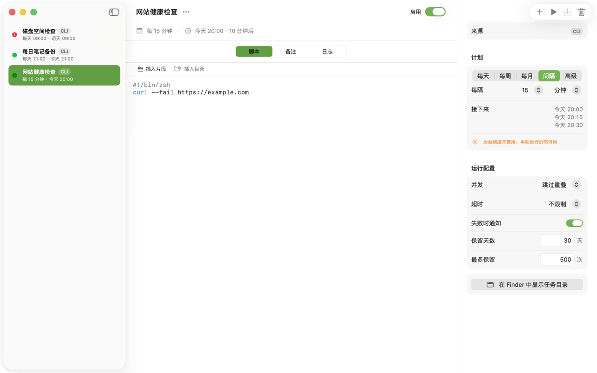
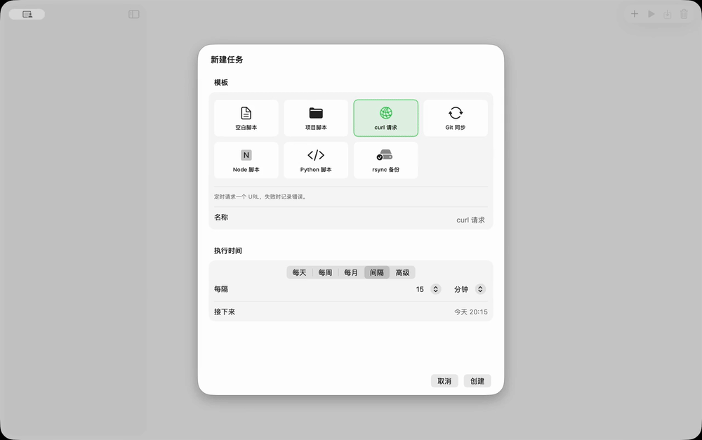
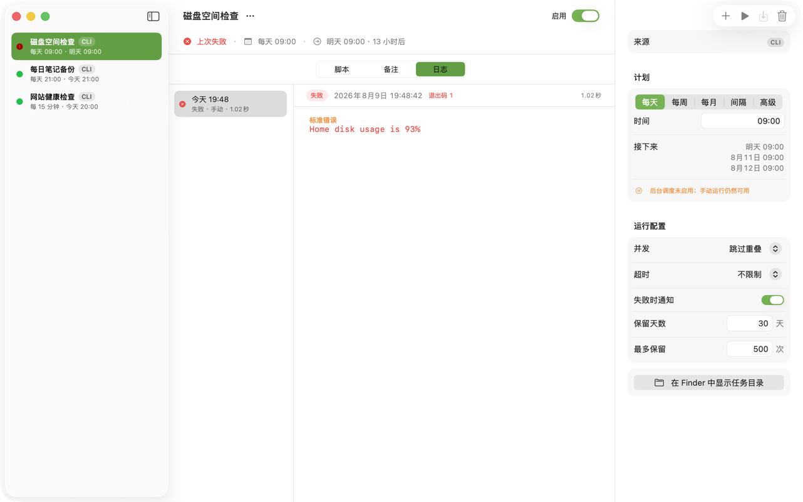

# Run Shelf

[](https://github.com/RuochenLyu/run-shelf/actions/workflows/check.yml)
[](LICENSE)

[简体中文](README.md) | English

Run Shelf is a local script manager for macOS. Put your everyday shell scripts in it, run them manually or on a cron schedule, and see each run's output, exit code, and failure reason.

It is not a cloud automation platform and needs no account. Tasks, scripts, notes, and run history live in plain files on your Mac and are never uploaded.



## Features

- File-native tasks: each task is a directory containing `task.json`, `run.sh`, `notes.md`, and its run history.
- Manual runs: records stdout, stderr, exit code, a script snapshot, duration, and status.
- Scheduling: 5-field cron; a background helper process keeps checking even after the main window is closed.
- Stop running tasks: timeouts, cancellation, and background termination clean up the whole process group.
- Safety hints: high-risk commands are flagged when editing and on CLI writes.
- Agent/CLI access: the bundled `runshelf` CLI lets Codex/Claude create, modify, run, and query tasks through a JSON contract.

## Requirements

```text
macOS 15 or later
```

macOS 15 is the minimum supported version. On macOS 26 the app naturally picks up the system's new visual style; macOS 15 and 16 share the same core feature set with the native control appearance available on those systems.

## Install

Download the latest `RunShelf-<version>-macOS15.dmg` from GitHub Releases, open it, and drag `Run Shelf.app` into `Applications`.

After the first launch you can enable background running in Settings. It is optional; without it, manual runs and task editing still work.

## Using the app

1. Create a task with a name, a schedule, and a script.
2. Run it manually and confirm stdout, stderr, and the exit code look right.
3. When you want it scheduled, enable the task and turn on background running in Settings.
4. When a run fails, open its history entry and inspect stdout/stderr.



[Full-quality video](docs/assets/demo.mp4)



Tasks are stored by default in:

```text
~/Library/Application Support/Run Shelf/tasks/
```

A task directory looks roughly like:

```text
task.json
run.sh
notes.md
runs/<run-id>/meta.json
runs/<run-id>/stdout.log
runs/<run-id>/stderr.log
runs/<run-id>/run.sh.snapshot
.run-claim/<run-id>/claim.json
```

`.run-claim` is the cross-process run registry: with `concurrency=skip` only one active claim is allowed at a time, while `concurrency=allow` keeps one claim per run id. The app, the background scheduler, and the CLI share this registry to query, cancel, and reclaim runs.

## Using the CLI

The released app bundles the CLI:

```zsh
/Applications/Run\ Shelf.app/Contents/Library/Helpers/runshelf
```

To type `runshelf` directly in your terminal:

```zsh
/Applications/Run\ Shelf.app/Contents/Library/Helpers/runshelf install-cli --json
```

The default zsh on macOS may not include `~/.local/bin`. If `command -v runshelf` finds nothing, add this line to `~/.zshrc`:

```zsh
export PATH="$HOME/.local/bin:$PATH"
```

Common commands:

```zsh
runshelf task list --json
runshelf task show <id|slug> --json
runshelf task delete <id|slug> --json
runshelf apply spec.json --dry-run --json
runshelf apply spec.json --json
runshelf apply spec.json --dry-run --expected-revision <revisionToken> --json  # preview an update
runshelf apply spec.json --expected-revision <revisionToken> --json   # update an existing task
runshelf run <id|slug> --wait --json
runshelf run <id|slug> --detach --json
runshelf run status <run-id> --json
runshelf run cancel <run-id> --json
runshelf run stop <run-id> --json                         # alias for cancel
runshelf run log <run-id> --stdout
runshelf run log <run-id> --stderr
runshelf run log <run-id> --bytes 262144 --json
runshelf run log <run-id> --full
runshelf doctor --json
runshelf help agent
runshelf schema task-spec --example
runshelf schema cli-result
runshelf version --json
```

`apply` takes a TaskSpec JSON, not a full `task.json`. When creating a task, internal policies you did not set use defaults; when updating, unset policies keep their existing values.
Unknown fields are rejected with a validation error; the only supported timezone value is the literal `local`. Logs return at most the last 1 MiB by default — JSON callers should check `truncated`, and only an explicit `--full` reads the whole file.

Every `--json` response includes `schemaVersion`; set `RUNSHELF_JSON=1` to force JSON output. `version --json` returns the app and envelope schema versions. A failed foreground run returns `ok: false`, `error.code: "run_failed"`, and exit code `8`, while retaining the complete run record in `result.run`. Schema commands print raw JSON rather than an envelope.

Minimal TaskSpec example:

```json
{
  "slug": "daily-report",
  "name": "Daily report",
  "enabled": true,
  "schedule": {
    "type": "cron",
    "expression": "0 9 * * *",
    "timezone": "local"
  },
  "timeoutSeconds": 600,
  "script": "#!/bin/zsh\nset -euo pipefail\n\nprintf 'ok\\n'\n",
  "notes": "Managed by the CLI."
}
```

To modify an existing task, first read `revisionToken` via `task show`, then pass it back with `apply --expected-revision`. If the app or another CLI changed the task in between, the CLI returns `conflict` instead of silently overwriting.
Omitting `--expected-revision` from any existing-task update, including `--dry-run`, returns `usage`/exit code `2` without writing. Slugs cannot use the CLI-reserved words `status`, `log`, `cancel`, or `stop`.

## Letting Codex/Claude drive it

Paste the following to Codex/Claude and it can operate tasks through the Run Shelf CLI contract:

```text
Use Run Shelf to manage my local automation tasks.

Rules:
1. Never edit task.json, run.sh, or notes.md under ~/Library/Application Support/Run Shelf/tasks/ directly.
2. Operate through the runshelf CLI; if runshelf is not on PATH, use /Applications/Run\ Shelf.app/Contents/Library/Helpers/runshelf.
3. First run `runshelf help agent` to read the conventions, then `runshelf doctor --json` to confirm the data directory.
4. Read tasks with `runshelf task list --json` and `runshelf task show <id|slug> --json`.
5. Write tasks with TaskSpec JSON. To create, run `runshelf apply spec.json --dry-run --json` first, then `runshelf apply spec.json --json`.
6. To update an existing task, first read result.revisionToken via task show, then run `runshelf apply spec.json --expected-revision <revisionToken> --json`; on conflict, re-read instead of forcing an overwrite.
7. Run tasks with `runshelf run <id|slug> --wait --json`; for long tasks use `--detach` and poll with `runshelf run status <run-id> --json`.
8. Stop a background run with `runshelf run cancel <run-id> --json`.
9. If a script triggers dangerous_command, do not add --allow-dangerous unless I explicitly confirm.
10. Address tasks by id or slug; never guess by name.
```

See [docs/agent-usage.md](docs/agent-usage.md) for the full agent guide (Chinese).

## Background scheduling

The app embeds a background helper process:

```text
Run Shelf.app/Contents/Library/LaunchServices/RunShelfScheduler
```

With background running enabled, the helper checks tasks every 30 seconds and matches cron at minute granularity. Runs that miss their catch-up window are recorded as `stale`; the main app reads a heartbeat file to display background status.

Scheduler state lives in:

```text
~/Library/Application Support/Run Shelf/scheduler-state.json
~/Library/Application Support/Run Shelf/scheduler-heartbeat.json
~/Library/Application Support/Run Shelf/scheduler.log
```

## Development and releases

Developer docs are split out from user docs (currently in Chinese):

- [docs/development.md](docs/development.md): building from source, tests, Xcode project generation, local CLI smoke checks.
- [docs/release.md](docs/release.md): signing, DMG, notarization, GitHub Releases.
- [docs/requirements.md](docs/requirements.md): product requirements and implementation constraints.
- [docs/roadmap.md](docs/roadmap.md): roadmap and deferred items.

## License

Run Shelf is released under the MIT License. See [LICENSE](LICENSE).
